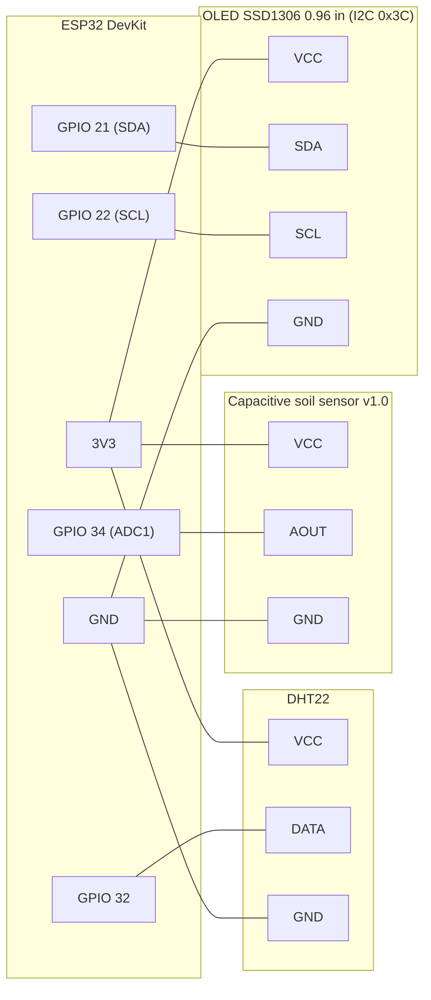

# 🌿 Green Guardian

ESP32 grow monitor: measures soil moisture, air temperature and humidity, shows them on an
OLED and a web dashboard, and sends alerts and reports via Telegram.

- Web dashboard with live values, VPD, dew point, heat index, 24 h history, min/max
- 10 s rolling averages
- Telegram bot: dry-soil / too hot / too cold alerts, daily report, `/status`, `/watered`, `/help`
- Automatic watering detection (sudden rise in soil moisture)
- OLED with rotating pages (mounted upside down, `setRotation(2)`)
- OTA updates over WiFi, settings stored in NVS (survive updates and reboots)
- Android home-screen widget: [PflanzenWidget](https://github.com/klaus1312trophobie/PflanzenWidget)

## Parts list

| # | Part | Notes |
|---|------|-------|
| 1 | ESP32 DevKit (ESP-WROOM-32, CP2102 USB-serial) | any ESP32 dev board with GPIO 21/22/32/34 works |
| 1 | DHT22 (AM2302) temperature & humidity sensor | module with 3 pins has the pull-up built in; bare 4-pin sensor needs a 10 kΩ pull-up between VCC and DATA |
| 1 | Capacitive soil moisture sensor v1.0 | analog output; the *capacitive* type, not the corroding resistive one |
| 1 | 0.96" OLED display, SSD1306, 128×64, I²C | address `0x3C` |
| – | Jumper wires / breadboard (or solder + perfboard) | |
| 1 | Micro-USB cable + 5 V USB power supply | |

## Wiring

| Part | Pin | ESP32 |
|------|-----|-------|
| DHT22 | VCC (+) | 3V3 |
| DHT22 | DATA (OUT) | **GPIO 32** |
| DHT22 | GND (−) | GND |
| Soil sensor | VCC | 3V3 |
| Soil sensor | AOUT | **GPIO 34** (ADC1, input only) |
| Soil sensor | GND | GND |
| OLED SSD1306 | VCC | 3V3 |
| OLED SSD1306 | SDA | **GPIO 21** |
| OLED SSD1306 | SCL | **GPIO 22** |
| OLED SSD1306 | GND | GND |

All parts run at 3.3 V, so no level shifting is needed. Soil sensor on 3.3 V keeps its
output within the ESP32 ADC range.

### Schematic



Same thing as plain text:

```
                    ┌─────────────────────┐
   DHT22            │                     │            OLED SSD1306
  ┌───────┐         │       ESP32         │         ┌────────────────┐
  │ VCC   ├─────────┤ 3V3                 │         │                │
  │ DATA  ├─────────┤ GPIO 32             │         │                │
  │ GND   ├─────────┤ GND                 │         │                │
  └───────┘         │                     │         │ VCC ───── 3V3  │
                    │            GPIO 21  ├─────────┤ SDA            │
   Soil sensor      │            GPIO 22  ├─────────┤ SCL            │
  ┌───────┐         │                     │         │ GND ───── GND  │
  │ VCC   ├─────────┤ 3V3                 │         └────────────────┘
  │ AOUT  ├─────────┤ GPIO 34 (ADC1)      │
  │ GND   ├─────────┤ GND                 │
  └───────┘         └──────────┬──────────┘
                               │ USB 5 V
```

## Setup

1. Install [PlatformIO](https://platformio.org/).
2. Copy the config template and fill in your values (WiFi, Telegram token + chat ID, OTA password):
   ```
   cp include/config.example.h include/config.h
   ```
   `include/config.h` is git-ignored because it contains secrets.
3. First flash over USB:
   ```
   pio run -e esp32dev_usb -t upload
   ```
4. After that, update over WiFi (OTA):
   ```
   pio run -t upload
   ```
   OTA uses a fixed host port (8266) so the firewall can allow it, e.g.
   `sudo ufw allow from 192.168.178.0/24 to any port 8266 proto tcp`.
5. Open `http://greenguardian.local` (or the IP shown on the OLED).

Calibration (dry / wet values), alert threshold and report hour are set in the dashboard
and stored in flash; they are kept across OTA updates.

## API

`GET /data` returns JSON, e.g.:

```json
{"moisture":87,"temp":25.7,"humidity":61.3,"vpd":0.91,"vpdStage":"vegetative sweet spot",
 "minmax":{"tempMin":24.3,"tempMax":25.8,"humMin":53.6,"humMax":61.3,"soilMin":86,"soilMax":100},
 "threshold":40,"lastWatered":1791899397,"rssi":-84}
```

The keys `moisture`, `temp` and `humidity` are used by the Android widget and must stay stable.
`GET /history` returns the 24 h history.

## Telegram commands

| Command | Action |
|---------|--------|
| `/status` | current values, min/max, last watering |
| `/watered` | log a watering manually |
| `/help` | command list and dashboard link |
